# Architecture

```mermaid
flowchart LR
  A[Audio and settings] --> B[Acoustic / rhythm / MusicFM features]
  B --> C[Base arrangement planner]
  C --> D[Optional role and density adapters]
  D --> E[Baseline or hierarchical section / phrase plan]
  E --> F[Validated style and density contract]
  F --> G[Count prediction and key placement]
  G --> H[Legality checks and export]
  H --> I[OSZ and execution diagnostics]
```

`studio/config.py` defines the single port and resource locations. `resources/catalog.json` owns public model identity; `catalog.py` verifies assets. `studio/loader.py` loads only the two retained native generator architectures and restores their inference policies. Shared ancestral model classes remain implementation dependencies; they are not selectable historical releases.

`studio/pipeline.py` orchestrates feature extraction, planners, decoding and export. `studio/contracts.py` validates settings and planner shapes before decoding. `studio/export.py` contains format conversion without importing training scripts. `generation_studio.py` handles HTTP uploads and reserves a single generation worker before acknowledging a request. `cli.py` provides the same pipeline for explicit CPU/CUDA offline inference.

The latest planner uses audio section/phrase structure and keeps legacy planning available. Neither role nor density adapters may silently choose different assets. Role-model construction preserves the downstream random stream. Export diagnostics distinguish upstream budgets from actual rows and notes.

Runtime data belongs outside the source tree. The model installer validates a strict file allowlist and every digest before replacing files. Upstream MusicFM source and weights are pinned separately. The wheel contains the web UI, catalog and required third-party license files.
